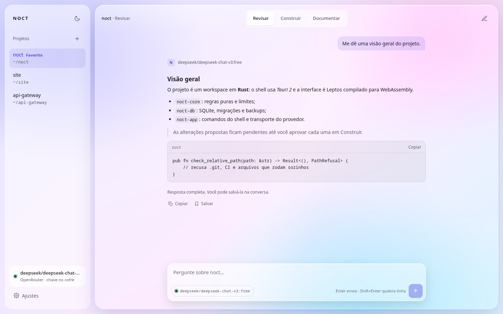
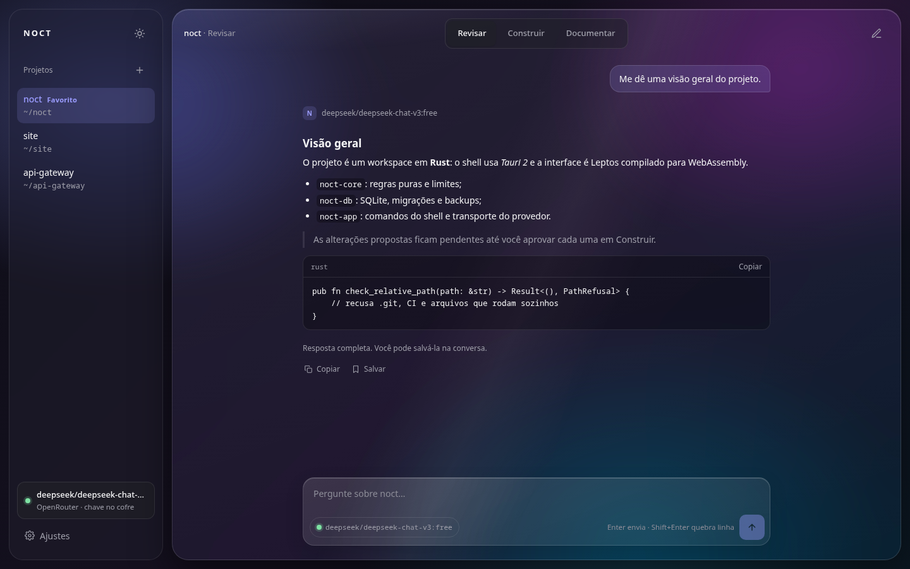

# NOCT: Rust shell and local persistence

[Português do Brasil](README.pt-BR.md)

> This repository holds the Rust product only: the Tauri shell, the SQLite layer, the provider credential vault and the
> Leptos interface. It is developed on `migration/rust` and merged into `main` by pull request; it is not a release yet.
> The previous product, written in TypeScript with its Electron shell, is kept at the tag `electron-final` (commit
> `c8c378b`). That tag is the restore point for everything removed from the repository.

The same view in the dark theme

The captures come from the interface check in Chromium, with a mocked shell and demonstration projects; they are not
from the real window. [docs/images/README.md](docs/images/README.md) says how they were made.

This file describes the branch after the removal of the previous product. Each statement names what it rests on. The
results of the local checks and of CI for the final commit are in [docs/status.md](docs/status.md). The removal, with
the decision for each group of files, is in [docs/ts-removal-plan.md](docs/ts-removal-plan.md).

## 1. What NOCT is

NOCT is a local desktop engineering workspace. It keeps the state of a developer's project and coordinates the developer
with AI providers that the user selects. The developer keeps the approval and the judgement. The application records
plans, approvals and validation results (`AGENTS.md`, "Product identity").

## 2. What this branch contains

| Path | Responsibility |
| --- | --- |
| `crates/noct-app` | The Tauri 2 shell. It opens the data folder and the log, registers its 37 commands, sets the window policy, and checks workspace access. |
| `crates/noct-core` | The contracts, limits and types of the product, and the log redaction. |
| `crates/noct-db` | SQLite persistence: the runtime, migrations 1 to 32, the repositories, backups and recovery snapshots, atomic writes, the file log and the operation observer. |
| `crates/noct-native` | A separate rollback worker binary for filesystem operations. It has a Linux backend only. |
| `crates/noct-secrets` | The provider credential vault: an encrypted document, a non-secret index, and a master key in the operating system credential store. The shell opens it to keep the OpenRouter key. |
| `crates/noct-ui` | The Leptos interface, compiled to WebAssembly by Trunk. The Geist fonts are vendored under the SIL Open Font License 1.1. |
| `native/` | The source of the C++ rollback worker. CI does not compile it. |
| `scripts/` | The launcher, the UI and CSP checks in Chromium, the shell release helper, and the Node tests of those scripts. |
| `docs/` | Architecture decisions, the status of the branch, and the runbooks. |

What this branch does not do yet:

- it calls one AI provider, OpenRouter, and only from the chat of Revisar (section 3);
- it writes a project file only when the person approves that change in Construir or Documentar, one change at a time;
- it does not list the saved conversations in the interface;
- it produces no installer or signed package;
- no window has been checked on Windows or on macOS (section 6).

## 3. Status

The phase table of [ADR 0001](docs/adr/0001-rust-migration.md) is the authority. In summary:

- **Phase 0, foundation:** done. The workspace builds on Linux, Windows and macOS in CI.
- **Phase 2, persistence:** in progress. Done: the runtime, migrations 1 to 32, the repositories, the public open path and
  the operation observer catalog. Open: a check on a copy of real data before any public release, and the observer has
  no call sites yet (phase 6).
- **Phase 3, native rollback:** Linux only. The Rust worker answers `UNSUPPORTED` on macOS and Windows. The missing parts
  are listed in [the backends document](docs/rust-native-rollback-backends.md).
- **Phase 4, workspace services:** partly done. The repositories exist; the services, such as `ProjectIndexService`, are
  not ported.
- **Phase 5, AI:** partly done. The credential vault, the network policy, the OpenRouter transport, its model list, the chat
  and the changes an answer proposes are done. Other provider adapters and the tool loop are not ported.
- **Phase 6, IPC and shell:** partly done. 37 commands, granted only to the `main` window.
- **Phase 7, UI:** partly done. Revisar (the chat, with answers drawn as Markdown without HTML), Construir and Documentar
  (the approval of each proposed change, with undo), Ajustes, the project list in the sidebar, the model picker, the glass
  layer and the themes. Checked in Chromium with a mocked shell; the real window on Linux was seen by the owner, and is
  not checked by CI.
- **Phase 8, updates and packaging:** not started on the Rust side. Blocked (section 4).
- **Phase 9, retirement:** the TypeScript product, its Vite and npm build and its Electron packaging are removed from this
  branch. The Node requirement stays for the Playwright checks. ADR 0001's table has not been changed by this removal.

### What the removal leaves out

The checks that compared the Rust code with the previous product ran against its compiled TypeScript. They are no longer
run on this branch:

- the row gate (10 tests), the Rust-written gate (2 tests) and the output differential over the nine release lines (1 test);
- the migration fixtures of the nine release lines, which were built from the tags' sources;
- the Windows persistence check, which repeated four TypeScript test files.

Their evidence and their runnable form are at `electron-final`. Nothing in this branch depends on them.

### What blocks phase 8

The ADR's criterion for phase 8 is "signed packages validated on three platforms". In the repository:

- **No packaging is configured.** `bundle.active` is `false` in `crates/noct-app/tauri.conf.json`.
- **No updater.** No updater crate is in `Cargo.lock`.
- **No signing configuration** exists in the Rust crates or in `tauri.conf.json`.
- **No holder for the signing keys.** ADR 0001, open decision 1, is not decided.
- **No equivalent of the packaging integrity checks** of the previous product (the Electron fuses and the ASAR integrity).
  ADR 0001 records this as a gap that "needs an explicit decision".
- **The shell has not run in a window on Windows or macOS**, so the criterion "validated on three platforms" cannot be
  met yet.
- **The platform floors are decided: Windows 10 and later, macOS 10.15 and later, and Ubuntu 22.04 and later for Linux.**
  ADR 0001, decision 4, is resolved for them. No CI job runs on Ubuntu 22.04.
  [`docs/compatibility.md`](docs/compatibility.md#minimum-platform-versions) has the decision and the Tauri statements
  behind them. Tauri gives no WebKitGTK version, and its macOS pages give two different values.

### OpenRouter provider (beta)

What the code does on this branch:

- The key is typed once in the settings area. The shell checks its format and saves it in the operating system's credential
  store. No network call checks it. The reply carries no key, and the interface never reads it back.
- Each project has a consent and a default model. The model is chosen from OpenRouter's list, which the shell reads through
  the same network policy, or typed as an identifier, and the shell checks its form.
- The chat answers a question about the project. It sends the top-level text files that the context rules allow, with the
  question, to `https://openrouter.ai/api/v1/chat/completions`, and shows the answer as it streams in. The transport allows
  HTTPS only, follows no redirect, checks every resolved address before it connects, and caps the size and the time. Save
  keeps the answer in a conversation.
- **The chat is on by default** since the owner tested a real key (2026-11-18). Ajustes can turn it off; the choice is kept in
  the `providerChatEnabled` setting. While it is off, a question is refused before any file is read and before any
  connection is made.
- **What is tested.** The chain from the question to the saved answer runs in the test suite against a local fake server
  (`crates/noct-app/tests/provider_chat_flow.rs` and `provider_transport.rs`). No test calls OpenRouter, and no run used a
  real key. The interface checks run in Chromium with a mocked shell.
- **Proposed changes.** An answer can propose file changes. They wait, pending, in Construir (or in Documentar for Markdown
  files) until the person approves each one; the path rules refuse Git, CI and self-running files, device names and encoded
  paths (`noct_core::file_change`).

Not done: other providers, and the tool loop.
The status of each item is in [docs/status.md](docs/status.md), "Beta 1 OpenRouter: report of this round" and the sections after it.

## 4. Verification

### Workflows on this branch

| Workflow | Runs | What it runs |
| --- | --- | --- |
| `rust-shell-validation.yml` | On a push to `migration/rust`, on a `rust-v*` tag, on a pull request to `main`, nightly at 03:17 UTC, and on manual dispatch | Three systems (Linux, Windows, macOS) on tags, pull requests, the nightly run and dispatch; Linux only on a push to the branch. Each builds the workspace, runs `cargo test --workspace --no-fail-fast`, and builds the release shell with the interface embedded. On Linux it also checks the permissions drift, the Content-Security-Policy and the settings area in Chromium, and runs the launcher and workflow tests. |
| `shell-release.yml` | On a `rust-v*` tag | The release. Its gate passes only when the tag's own run of `rust-shell-validation.yml` succeeded on all three systems. No `rust-v*` tag exists yet, so it has not run. |
| `keyring-round-trip.yml` | When `crates/noct-secrets/**`, `Cargo.toml`, `Cargo.lock` or the workflow change | The unit tests and the `os_store` round trip with the real operating system store, on three systems. |
| `rust-audit.yml` | When `Cargo.toml`, `Cargo.lock`, `deny.toml` or the workflow change, weekly, and on dispatch | `cargo deny check` and `cargo audit`. |
| `dependency-security.yml` | On pushes to `main` and on pull requests that change `package.json`, the lock or the workflow, weekly, and on dispatch | `npm audit` of the production and the development tree, and a CycloneDX SBOM of the Playwright tree. |
| `build-provenance-dry-run.yml` | On a push to `migration/rust` that changes it, and on dispatch | A dry run of build provenance attestation. It attests a small subject file made from the commit and the run, and publishes nothing: no release, no asset and no package. |

A job's result is `success` when every step that ran passed. The results for the final commit are in
[docs/status.md](docs/status.md).

### What CI does not cover

- No job opens a window. A window is checked by hand.
- The Chromium checks run on Linux only.
- Windows and macOS run the build, the workspace tests and the release build with the interface embedded.
- The C++ rollback worker is not compiled or tested in CI. Its source is kept in `native/`.
- No job compares the Rust code with the previous product. Section 3 lists what was removed for that.
- The Windows persistence check of four TypeScript files was removed with them. Its record is in
  [`docs/windows-persistence-flake.md`](docs/windows-persistence-flake.md). Its cause was not established.

### Seen in a real window

| Platform | What was seen | Where it is recorded |
| --- | --- | --- |
| Linux, WebKitGTK | Dev mode and release mode were opened by hand. Both showed the settings area with its default values, and `settings_get` ran end to end. This was the interface before the current layout. | `docs/rust-shell.md`, "Manual check, Linux (WebKitGTK)" |
| Windows, WebView2 | Nothing. | none |
| macOS, WKWebView | Nothing. | none |

Not seen in any window, on any platform:

- the sidebar with real workspaces, and the current layout;
- the minimum window size as the window manager enforces it;
- the navigation policy in a running webview;
- the commands called from a running window (`settings_get`, `settings_set` for the theme and the settings of the settings
  area, `workspaces_list`, `conversations_list` and `workspace_set_favorite`). The browser check uses a mocked shell, and
  the Rust tests use Tauri's mock runtime;
- the cost of the glass layer, which was not measured;
- the warning for a data folder outside the user's profile, on a real Windows profile.

### Ignored tests

Six tests are ignored. None of them runs in `cargo test --workspace`, and none is a gate:

| Test | Count | How it runs | Why it is ignored |
| --- | --- | --- | --- |
| `crates/noct-secrets/tests/os_store.rs` | 1 | `cargo test -p noct-secrets --test os_store -- --ignored --nocapture` | It needs the operating system credential store. It uses its own service name and does not touch the master key of an installed application (ADR 0002). `keyring-round-trip.yml` runs it on each system. |
| Benchmarks in `crates/noct-db/src/repositories/semantic_index.rs` | 4 | Release mode, `--ignored --nocapture` | They are measurements, with no budget set. |
| `crates/noct-db/tests/semantic_statistics.rs` | 1 | Release mode, `--ignored --nocapture` | It is a measurement. |

## 5. How to run

### Requirements

- Rust 1.97.1, which `rust-toolchain.toml` pins, with the `wasm32-unknown-unknown` target.
- trunk 0.22.1: `cargo install --locked trunk@0.22.1`.
- Node.js 24 (`>=24.18 <25`) and npm 11, with `npm ci` at the repository root. Node runs the launcher and the Playwright
  checks only.
- On Linux, the system packages that CI installs for Tauri: `build-essential`, `libssl-dev`, `libwebkit2gtk-4.1-dev`,
  `libgtk-3-dev`, `libxdo-dev`, `librsvg2-dev` and `libayatana-appindicator3-dev`.

### Commands

The launcher is `scripts/run-rust-shell.mjs`. Its options are `--data-dir <absolute path>` and `--check`.

| Command | What it does |
| --- | --- |
| `node scripts/run-rust-shell.mjs dev --check` | Prints the plan of the development mode and checks the tools. Starts nothing. |
| `node scripts/run-rust-shell.mjs release --check` | The same plan for the release mode. |
| `node scripts/run-rust-shell.mjs dev --data-dir <empty temporary folder> --check` | The same plan with the data folder given. |
| `node scripts/run-rust-shell.mjs dev` | Starts `trunk serve` on port 1420 and runs `cargo run -p noct-app`. This opens a window. |
| `node scripts/run-rust-shell.mjs release` | Runs `trunk build --release` and the release build, then opens a window. |
| `cargo build -p noct-app --release --features custom-protocol` | Builds the release shell with the interface embedded. |
| `npm test` | Runs the Node tests of the scripts (`scripts/*.test.mjs`). |
| `npm run check:csp` | Checks the Content-Security-Policy in Chromium. |
| `npm run check:ui` | Checks the interface (conversation, Markdown answers, model picker, Construir, Documentar, Ajustes) with a mocked shell in Chromium. |

> **Never point the shell at a data folder that holds real data.** Without `--data-dir`, the shell uses its default data
> folder, and that is where the data of a real user of the Rust shell is kept. For tests, use `--data-dir` with an empty
> folder that you create for the test and delete afterwards. On Windows, a data folder outside the user's profile is
> written to the log as a warning, and the shell still opens it.

## 6. Security model

### In place

- **Webview policy.** `withGlobalTauri` is `false`. The Content-Security-Policy is
  `default-src 'self'; script-src 'self' 'wasm-unsafe-eval'; style-src 'self'; img-src 'self' data: blob:; connect-src 'self' ipc: http://ipc.localhost`.
  Chromium checks it (`scripts/check-shell-csp.mjs`). No webview has enforced it yet.
- **Commands.** 37 commands are declared in `crates/noct-app/src/command_names.rs`, and `build.rs` turns them into the
  application manifest. `crates/noct-app/capabilities/default.json` grants them to the `main` window only. Tests with Tauri's
  mock runtime refuse a command that is not granted and a request from a second window.
- **Navigation.** The main window accepts navigation only to the packaged interface, and to the development server in
  debug builds (`crates/noct-app/src/navigation.rs`, with its tests). This is not verified in a running webview.
- **Browser permissions.** The webview grants nothing beyond `core:default` (ADR 0001, security table). Not verified in a
  running webview.
- **Credentials.** The database holds only a UUID reference for each provider configuration. The vault encrypts the
  credentials with XChaCha20-Poly1305 and keeps the master key in the operating system credential store (ADR 0002). The
  shell opens the vault for the OpenRouter key; the key never reaches the interface or the logs.
- **The webview is not a browser in a release build.** No page menu on a right click (except in text fields and over a
  selection), no reload, navigation or print shortcut, no navigation to a dropped file, and no inspector
  (`crates/noct-ui/src/browser_guard.rs`, `crates/noct-app/src/window.rs`).
- **Logs.** Lines are redacted before they are queued for the file log (`crates/noct-core/src/log_redaction.rs`).
- **Local files.** On Unix, the database, its backups, the logs and the atomic writes are created with mode `0600`, and
  the folders with `0700`. On Windows, no ACL is applied (see the list below).
- **Restored workspaces.** A restored backup sets `authorized` to `0`. The workspace must be selected again before the
  shell trusts it (`crates/noct-db/src/repositories/backup.rs`).

### Still missing

- **Provider allowlist beyond OpenRouter.** The network policy (`crates/noct-core/src/ai/network.rs`) holds OpenRouter
  alone, with the restrictive answers to the design's questions (`docs/provider-allowlist-design.md`, section 13). Hosts
  that the user approves, and local endpoints, are not implemented.
- **Windows ACL.** The data folder gets no DACL. Setting one needs `windows-sys` as a direct dependency, which the owner
  has not approved. The owner decided that it waits for the vault integration, with the owner present. The analysis is in
  `docs/rust-windows-file-permissions.md`.
- **Packaging integrity.** The previous product's fuses and ASAR integrity have no equivalent here. ADR 0001 marks this as
  a gap that needs a decision.
- **Workspace access check.** It approximates `access(R_OK | X_OK)` without a native call. Its tests do not cover ACLs,
  other users or group access (`docs/rust-shell.md`, "Known approximations").
- **npm dependencies.** The branch's npm tree is the Playwright dependency alone. `npm audit` of it is in the
  `dependency-security.yml` workflow. The audit of the previous tree, with its 13 moderate findings in development tooling,
  is in [`docs/npm-audit-triage.md`](docs/npm-audit-triage.md). None of those findings was decided.

## 7. Compatibility and rollback

- **Schema.** The schema version is 32, and the Rust migrations 1 to 32 are in `crates/noct-db/src/migrations/generated.rs`.
  `crates/noct-db/tests/migration_parity.rs` checks them against `crates/noct-db/tests/fixtures/schema-hashes.json`, which
  was produced from the previous product's migrations and is kept as data. This branch adds no migration after 32.
- **Databases already at 32.** They open with no schema change.
- **Older databases.** The Rust runtime writes a backup before it runs the migrations of an older database, keeps up to
  three, and runs the migrations inside transactions. The comparison of the result with the previous product for the nine
  pinned release lines is not run on this branch. Its fixtures are at `electron-final`.
- **Newer databases.** The runtime refuses a schema newer than 32 before it changes anything.
- **Rollback to the previous product.** This branch cannot be checked against it any more. The checks that did it are at
  `electron-final`. Both use schema 32, so a file written by one should open in the other, but that is not tested here.
- **Rollback on macOS and Windows.** The Rust worker answers `UNSUPPORTED` on those platforms. The C++ worker in `native/`
  has backends for both, and it is not compiled by CI. The missing parts are listed in
  [the backends document](docs/rust-native-rollback-backends.md).
- **Provider credentials are not migrated.** ADR 0001, decision 6, proposes that users enter their provider keys again
  once, after the migration. That is pending confirmation.
- **Not the same rollback.** `noct-native` rolls back filesystem operations. It does not roll back the database.

## 8. Tests

### Local checks

The commands below are the ones the branch's workflow and this README use. Their results at the final commit are in
[docs/status.md](docs/status.md).

| Command | What it checks |
| --- | --- |
| `cargo fmt --all -- --check` | Formatting. |
| `cargo clippy --workspace --all-targets -- -D warnings` | Lints, as errors. |
| `cargo test --workspace --no-fail-fast` | All the Rust tests that are not ignored. |
| `cd crates/noct-ui && trunk build --release` | The interface compiles to WebAssembly. |
| `npm test` | The Node tests of the scripts. |
| `npm run check:ui`, `npm run check:csp` | The interface and the policy in Chromium. |

The Node tests cover the launcher's options, the release workflow's gate, the `latest.json` of the shell, and the
caching of the Rust shell workflow.

## 9. Code signing and installers

- This branch has no code signing: no certificate, no notarization and no signed updater artifact.
- `bundle.active` is `false`, so this branch produces no installer.
- A binary built from this branch is unsigned. Windows and macOS have no publisher identity to check for it. The only way
  to check where it came from is to build it from the commit yourself.
- The product on `main` has its own release policy. It is not described here, and this branch does not change it. The
  choice of who holds the signing keys is open (ADR 0001, open decision 1).

## 10. Documentation and next steps

### Documents

- [ADR 0001: Rust migration](docs/adr/0001-rust-migration.md). Phases, progress, security invariants and open decisions.
  Its status is "Proposed".
- [ADR 0002: envelope encryption of provider credentials](docs/adr/0002-envelope-provider-credentials.md). Accepted.
  It partly supersedes decision 6 of ADR 0001.
- [Removal of the previous product from this branch](docs/ts-removal-plan.md). The inventory, the decision for each
  group, and what each step checked.
- [Status of the branch](docs/status.md). The report of each round, with its results and its open items.
- [Running the Rust shell locally](docs/rust-shell.md). The run modes, what is verified, the manual check, the gaps in CI,
  and the known approximations.
- [Minimum platform versions](docs/compatibility.md#minimum-platform-versions). The decided floors, the Tauri pages they
  cite, and what is not confirmed.
- [Rust rollback backends](docs/rust-native-rollback-backends.md). What the macOS and Windows backends must match, and what
  is missing.
- [Windows file permissions](docs/rust-windows-file-permissions.md). The analysis, the warning, and the ACL that is not
  implemented.
- [Provider allowlist design](docs/provider-allowlist-design.md). The design, and in section 13 the answers that the
  network policy implements for OpenRouter.
- [npm audit triage](docs/npm-audit-triage.md). The findings of the previous tree, their scope, and the options. Nothing is
  fixed.
- [Documentation index](docs/README.md). The other documents. Some describe the previous product; they are kept as history.
- [`AGENTS.md`](AGENTS.md). Contributor rules, the shell's security invariants and the validation commands.

### Next steps

1. **Owner.** Decide the providers and the user-approved hosts after OpenRouter (`docs/provider-allowlist-design.md`).
2. **Owner, with the owner present.** Decide on `windows-sys` or on declarations in the repository, and on the Windows
   ACL, during the vault integration (section 6).
3. **Real windows.** Open the shell on Windows (WebView2) and macOS (WKWebView). On Linux, check the current layout and the
   sidebar with real workspaces, and check the minimum window size.
4. **Phase 2.** Connect the operation observer to the phase 6 call sites. Before any public release, check the rows of a
   copy of real data, kept under `target/` and never committed.
5. **Phase 3.** Write the macOS (APFS clone) and Windows rollback backends, or decide that the C++ worker keeps those
   platforms. The details are in `docs/rust-native-rollback-backends.md`.
6. **Phase 5.** Port the provider adapters and the tool loop.
7. **Phase 8 decisions.** Who holds the signing keys, and how the packaging integrity checks are replaced. The macOS bundle
   setting is still to be written.
8. **Owner decisions on the repository.** These are outside the files of this branch:
   - the CodeQL language set contains `javascript-typescript`, and no JavaScript product remains on this branch;
   - whether the parity checks should be recreated as Rust-only tests against frozen data, on a separate branch or tag;
   - whether the row-gate parity coverage is accepted as ended on this branch.
9. **Owner.** Decide the npm audit option for the previous tree (`docs/npm-audit-triage.md`).

### Conflicts between the sources

- ADR 0001's phase table still describes the TypeScript and Electron paths of the previous product, and phase 9 is not
  marked done. This README reports the removal; the ADR has not been changed for it.
- `docs/provider-allowlist-design.md` still says "Nothing is implemented" in its header; the network policy implements it
  for OpenRouter (section 6).
