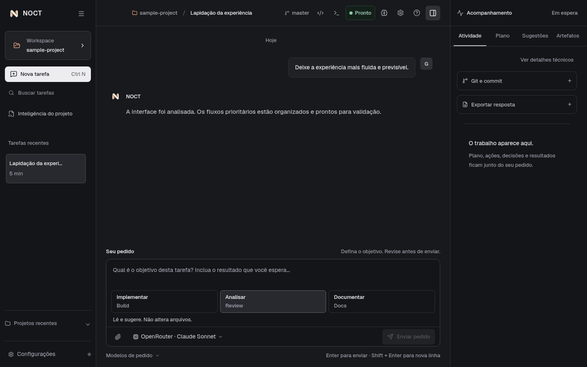
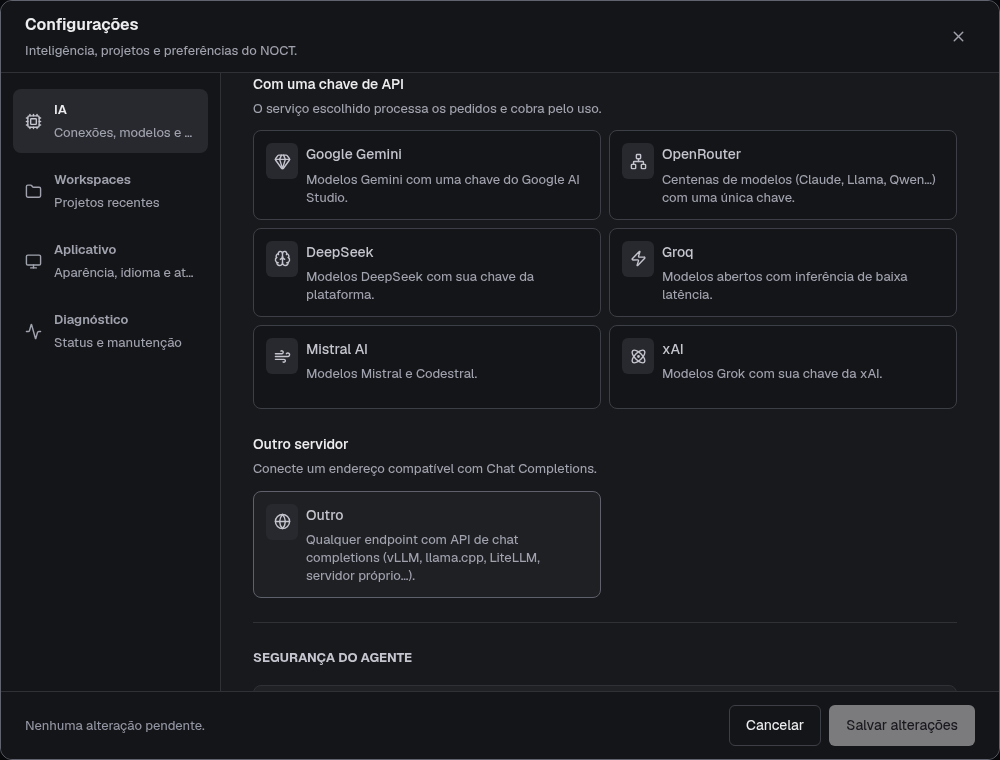
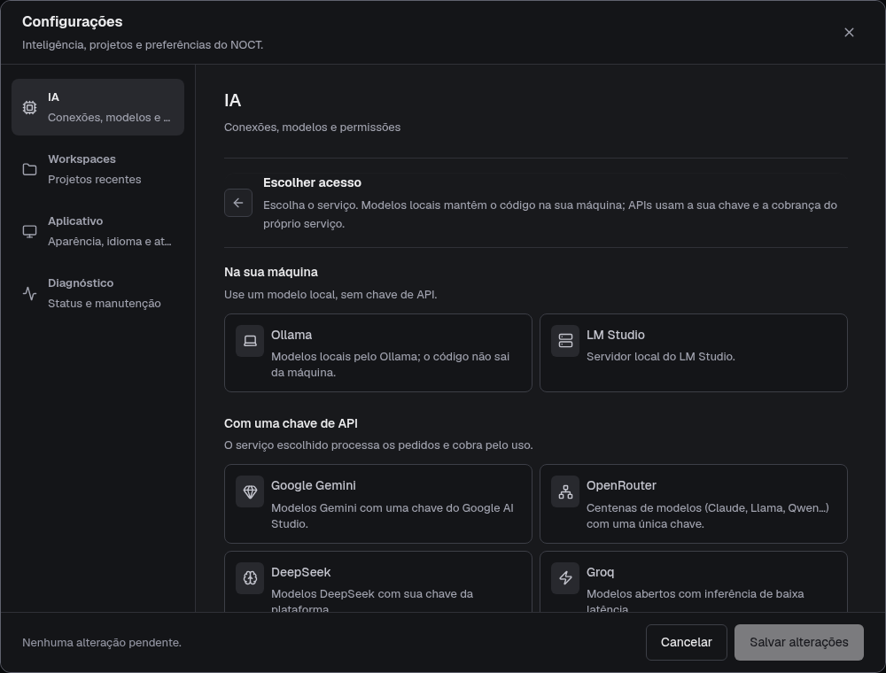
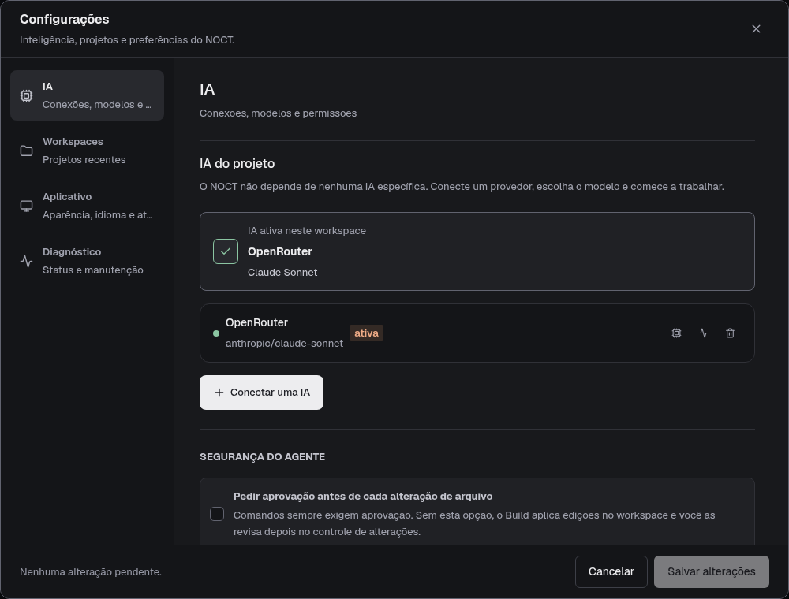

# NOCT

[Português do Brasil](README.pt-BR.md)

> A local-first desktop workspace for understanding, reviewing and evolving real software projects with the AI you choose.

NOCT is free software under the MIT license. It keeps a project's
workspace, conversations, engineering findings and durable knowledge together.
It is a desktop engineering workspace, not an IDE, an autonomous replacement
for a developer, or an official product of any AI vendor. It does not depend on
a specific AI, company or CLI: download it, connect an API or local model,
choose the model for your workspace and start working.

It addresses the context fragmentation of prompt-only tools: project state,
review evidence, decisions and approved knowledge remain connected instead of
being reconstructed in every conversation.



Screenshots show the current interface in Portuguese with demonstration data.
The request stays in the center, with plans and approvals alongside it.
Project context can be collapsed; Analyze, Implement and Document say what each
mode does to the project before you send.

## What it does

- **Workspaces:** explicitly select and authorize a project directory; moved or
  restored workspaces remain unauthorized until selected again.
- **Review Mode:** read-only analysis with evidence-backed suggestions and
  reconciliation of new, persistent and resolved findings.
- **Build Mode:** agent-assisted changes inside the authorized workspace with
  any tool-capable model, with command approvals, progress, a visible diff and
  guarded rollback when its preconditions are met.
- **Docs Mode:** preview, compare and apply incremental Markdown updates with
  confirmation, concurrency checks and atomic writes.
- **Second Brain and Awareness:** local, structured memories with approval,
  scope, freshness and an explanation of the context selected for each run.
- **Conversations and Git:** persistent conversations, paginated histories,
  workspace Git status and commit preparation.
- **Provider layer:** Google Gemini, OpenRouter, DeepSeek, Groq, Mistral, xAI,
  Ollama, LM Studio or any endpoint that implements chat completions. Nocturne
  depends on no AI vendor, CLI or subscription.

The developer remains responsible for intent, approval, review and the final
change to a project.

## Supported release artifacts

[Download the stable v1.0.5 release](https://github.com/gustavomfg/NOCT/releases/tag/v1.0.5).

Official release validation currently covers:

| Platform | Artifact configured by the build |
| --- | --- |
| Windows 10/11 | x64 NSIS installer (`.exe`) |
| Linux desktop | AppImage and `tar.gz` (the published build architecture applies) |
| macOS | DMG and updater ZIP (the published build architecture applies) |

Unsigned package validation runs on Linux, Windows and macOS. Stable releases
publish the configured targets for all three platforms: Linux has a protected
GPG-signed checksum manifest, while Windows and macOS currently publish
checksums without platform signing/notarization. See
[installation](docs/installation.md) and [updates](docs/updates.md).

## Choose your AI

1. Open **Settings → AI** (or click the AI chip below the message box).
2. Click **Connect an AI** and pick a service: an API key (Gemini, OpenRouter,
   DeepSeek, Groq, Mistral, xAI), a local runtime (Ollama, LM Studio) or
   **Other** for any endpoint that implements chat completions (vLLM,
   llama.cpp, LiteLLM, your own server).
3. Choose the model for the current workspace. The chip in the composer shows
   which service and model the next run will use.



<details>
<summary>Local runtimes, custom endpoints and the active model</summary>

Ollama, LM Studio and custom endpoints use the same connection flow.



The active connection shows the provider and model bound to the workspace.



</details>

Review, Build and Docs all run through the selected model. Nocturne gives the
model a small set of workspace tools executed in the main process:
`list_directory`, `read_file` and `search_text` in every mode, plus
`write_file`, `edit_file` and `run_command` in Build only. Every path is
constrained to the authorized root, generated directories and likely secret
files (`.env`, keys, credentials) are refused, every command waits for your
approval and runs without a shell, and every Build change is captured
BEFORE/AFTER for review and rollback. Settings → AI can also ask for approval
before each file change. Build needs a model that supports function calling;
Review and Docs fall back to the context Nocturne selected when a chat-only
model rejects tools.

Subscription login is not offered: consumer plans do not expose a supported
login for third-party apps. Use an API key, an aggregator such as OpenRouter (one
key for models from many vendors) or a local model. See
[providers](docs/providers.md).

Provider API credentials are encrypted by the operating-system secure storage,
kept in the main process and excluded from backups and diagnostics.

On Linux, a working, unlocked Secret Service or KWallet is required to save API
keys. Nocturne detects installed keyrings on Hyprland and similar desktops.
See [connection troubleshooting](docs/providers.md#connection-troubleshooting).

## Local data and recovery

Conversations, settings, model catalog data and structured knowledge are stored
in a local SQLite database. Workspace context files use bounded, atomic writes.
The application validates the database, creates snapshots before destructive
data operations and can quarantine a corrupt database before restoring a valid
candidate with user confirmation. Backups do not include project files or
provider credentials. These mechanisms reduce recovery risk; they are not a
promise of absolute durability against every hardware or filesystem failure.

Read [backup and recovery](docs/backup-and-recovery.md) before moving or
restoring a workspace.

## Security and privacy

The renderer runs with isolation, sandboxing and no Node.js integration. Native
capabilities cross named preload APIs and validated IPC handlers. Workspace paths
are contained and rechecked, Review remains read-only, and remote providers use
HTTPS with address validation. Nocturne is local-first, but selected prompts,
context, attachments and the output of tools the model calls are sent to the
provider the user chooses; a local runtime such as Ollama keeps them on the
machine. See
[security](docs/security.md), [privacy](docs/privacy.md) and
[SECURITY.md](SECURITY.md).

## Requirements for development

- Node.js `>=24.18 <25`
- npm `>=11 <12`
- native build tooling compatible with `better-sqlite3`

```bash
npm ci
npm run dev
```

The full command list is in [development](docs/development.md).

## Current status

The `v1.0.5` stable release uses `gustavomfg/NOCT` as its publication and
updater repository. A version tag starts the GitHub-hosted release workflow,
which validates the source, all platform inventories and published assets.
Linux checksums are GPG-signed; Windows and macOS remain unsigned, and macOS
remains unnotarized under the current policy.

Known limitations: agents depend on the model's function-calling quality,
commands run on the host without an OS sandbox (approval is the boundary), and a
run stops after a bounded number of tool steps. Dedicated native adapters for other protocols, marketplace, cloud collaboration and
multi-agent orchestration are not part of this release contract.

## Documentation

- [Documentation index](docs/README.md) · [Português](docs/README.pt-BR.md)
- [Installation](docs/installation.md) · [Português](docs/installation.pt-BR.md)
- [Getting started](docs/getting-started.md) · [Português](docs/getting-started.pt-BR.md)
- [Providers](docs/providers.md) · [Português](docs/providers.pt-BR.md)
- [Configuration](docs/configuration.md) · [Português](docs/configuration.pt-BR.md)
- [Review, Build and Docs modes](docs/modes.md) · [Português](docs/modes.pt-BR.md)
- [Second Brain and Awareness](docs/second-brain.md) · [Português](docs/second-brain.pt-BR.md)
- [Backup and recovery](docs/backup-and-recovery.md) · [Português](docs/backup-and-recovery.pt-BR.md)
- [Updates](docs/updates.md) · [Português](docs/updates.pt-BR.md)
- [Security](docs/security.md) · [Português](docs/security.pt-BR.md)
- [Privacy](docs/privacy.md) · [Português](docs/privacy.pt-BR.md)
- [Troubleshooting](docs/troubleshooting.md) · [Português](docs/troubleshooting.pt-BR.md)
- [Development](docs/development.md) · [Português](docs/development.pt-BR.md)
- [Architecture](docs/architecture.md) · [Português](docs/architecture.pt-BR.md)
- [1.0.5 release notes](docs/releases/v1.0.5.md) · [Português](docs/releases/v1.0.5.pt-BR.md)
- [GitHub Actions and releases](docs/github-actions.md)
- [1.0.2 historical release readiness](docs/release-readiness-1.0.2.md)
- [1.0.1 historical release notes](docs/releases/v1.0.1.md) · [Português](docs/releases/v1.0.1.pt-BR.md)
- [Release-candidate checklist](docs/release-rc-checklist.md) · [Português](docs/release-rc-checklist.pt-BR.md)
- [1.0.1 historical release readiness](docs/release-readiness-1.0.md)

English is the canonical public source. Portuguese translations use the
`.pt-BR.md` suffix and preserve headings, commands, paths and technical names.

## License

NOCT is distributed under the [MIT License](LICENSE).
