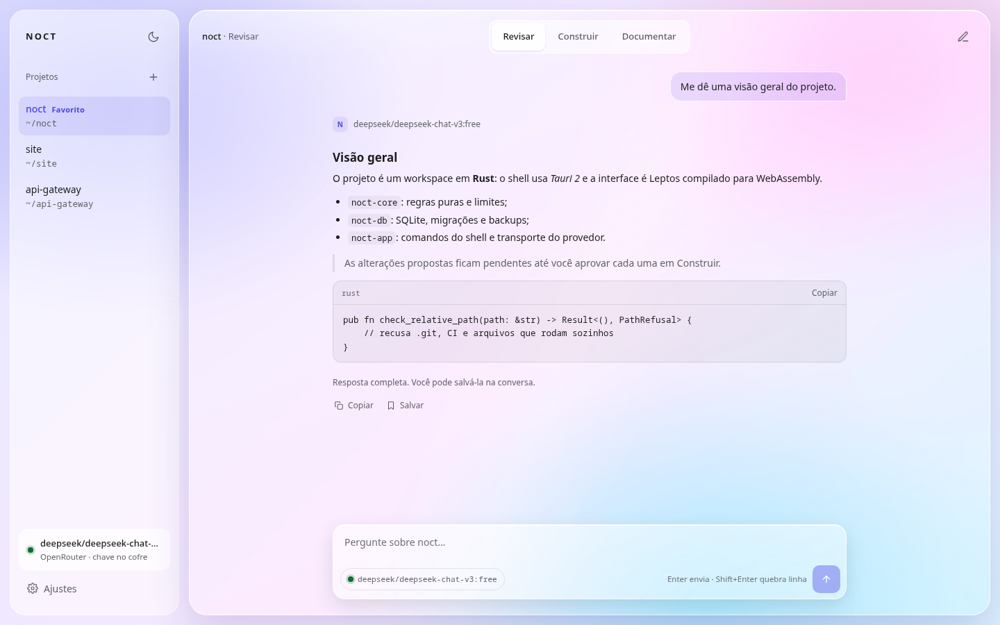
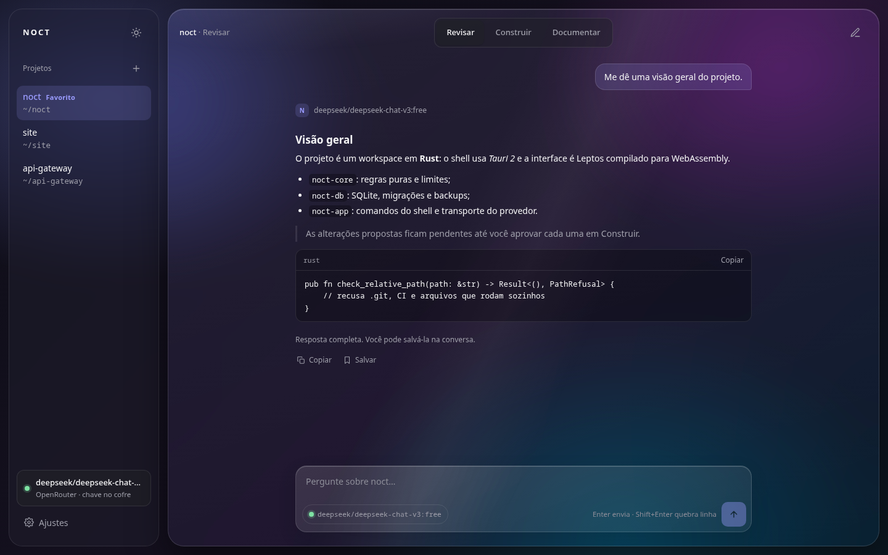

# NOCT: shell em Rust e persistência local

[English](README.md)

> Este repositório reúne apenas o produto em Rust: o shell Tauri, a camada SQLite, o cofre de credenciais dos provedores e
> a interface Leptos. Ele é desenvolvido em `migration/rust` e mesclado na `main` por pull request; ainda não é uma versão.
> O produto anterior, escrito em TypeScript com o shell Electron, fica preservado na tag `electron-final` (commit
> `c8c378b`). Essa tag é o ponto de restauração de tudo o que foi removido do repositório.



<details>
<summary>A mesma tela no tema escuro</summary>



</details>

As capturas vêm da checagem da interface no Chromium, com um shell simulado e projetos de demonstração; não são da janela
real. [docs/images/README.md](docs/images/README.md) diz como foram feitas.

Este arquivo descreve o branch depois da remoção do produto anterior. Cada afirmação diz no que se apoia. Os resultados
das checagens locais e do CI do commit final estão em [docs/status.md](docs/status.md). A remoção, com a decisão para cada
grupo de arquivos, está em [docs/ts-removal-plan.md](docs/ts-removal-plan.md).

## Instalar

> **Os instaladores não são assinados pelo sistema operacional.** O NOCT não tem certificado de assinatura de código do
> Windows nem Apple Developer ID, e não é notarizado. Windows e macOS avisam antes da primeira abertura; os passos abaixo
> passam pelo aviso. Confira antes o SHA256 do arquivo: é a única prova de que o arquivo é o que o projeto gerou.

Baixe o instalador do seu sistema e o arquivo `SHA256SUMS` na página da release (ou no artefato `noct-installers` de uma
execução do workflow `build-installers`). Os nomes dos arquivos trazem a versão, por exemplo `NOCT_<versão>_amd64.deb`.

### Conferir o SHA256

```bash
# Linux e macOS, na pasta dos downloads
sha256sum --ignore-missing -c SHA256SUMS      # Linux
shasum -a 256 --ignore-missing -c SHA256SUMS  # macOS
```

```powershell
# Windows (PowerShell): compare o resultado com a linha do arquivo em SHA256SUMS
Get-FileHash .\NOCT_<versão>_x64-setup.exe -Algorithm SHA256
```

Cada linha deve dizer `OK` (ou, no Windows, os dois hashes devem ser iguais). Se alguma não disser, não abra o arquivo.

### Linux

- **.deb** (Debian, Ubuntu 22.04 ou mais novo): `sudo apt install ./NOCT_<versão>_amd64.deb`
- **AppImage** (outras distribuições): torne o arquivo executável e rode.

  ```bash
  chmod +x NOCT_<versão>_amd64.AppImage
  ./NOCT_<versão>_amd64.AppImage
  ```

### Windows

Rode `NOCT_<versão>_x64-setup.exe`. O SmartScreen mostra "O Windows protegeu o computador": clique em **Mais
informações** e depois em **Executar assim mesmo**. Windows 10 ou mais novo.

### macOS

Abra o `.dmg` do seu Mac (`aarch64` para Apple silicon, `x64` para Intel) e arraste o NOCT para Aplicativos. O Gatekeeper
recusa a primeira abertura de um app não notarizado. Clique com o botão direito no NOCT em Aplicativos, escolha **Abrir**
e confirme; ou remova a marca de quarentena no Terminal:

```bash
xattr -dr com.apple.quarantine /Applications/NOCT.app
```

macOS 10.15 ou mais novo.

## 1. O que é o NOCT

O NOCT é um workspace desktop local de engenharia. Ele mantém o estado do projeto de um desenvolvedor e coordena o
desenvolvedor com os provedores de IA que o usuário escolhe. A aprovação e o julgamento ficam com o desenvolvedor. O
aplicativo registra planos, aprovações e resultados de validação (`AGENTS.md`, "Product identity").

## 2. O que este branch contém

| Caminho | Responsabilidade |
| --- | --- |
| `crates/noct-app` | O shell Tauri 2. Abre a pasta de dados e o log, registra seus 40 comandos, define a política da janela e confere o acesso aos workspaces. |
| `crates/noct-core` | Os contratos, limites e tipos do produto, e a redação do log. |
| `crates/noct-db` | Persistência SQLite: o runtime, as migrações 1 a 32, os repositórios, backups e instantâneos de recuperação, escritas atômicas, o log em arquivo e o observador de operações. |
| `crates/noct-native` | Um binário separado, o worker de rollback de operações de arquivo. Tem backend só para Linux. |
| `crates/noct-secrets` | O cofre de credenciais dos provedores: um documento cifrado, um índice sem segredos e uma chave-mestra no cofre de credenciais do sistema operacional. O shell o abre para guardar a chave do OpenRouter. |
| `crates/noct-ui` | A interface Leptos, compilada para WebAssembly pelo Trunk. As fontes Geist estão incluídas no repositório sob a SIL Open Font License 1.1. |
| `native/` | O código-fonte do worker de rollback em C++. O CI não o compila. |
| `scripts/` | O lançador, as checagens de CSP e da interface no Chromium, o auxiliar de release do shell e os testes Node desses scripts. |
| `docs/` | Decisões de arquitetura, o estado do branch e os roteiros. |

O que este branch ainda não faz:

- chama um único provedor de IA, o OpenRouter, e só pelo chat de Revisar (seção 3);
- grava um arquivo do projeto só quando a pessoa aprova aquela alteração em Construir ou Documentar, uma de cada vez;
- não lista as conversas salvas na interface;
- seus instaladores não são assinados pelo sistema operacional, e o atualizador ainda não publicou nenhuma versão;
- nenhuma janela foi conferida no Windows nem no macOS (seção 6).

## 3. Estado

A tabela de fases da [ADR 0001](docs/adr/0001-rust-migration.md) é a referência. Em resumo:

- **Fase 0, fundação:** concluída. O workspace compila no Linux, no Windows e no macOS no CI.
- **Fase 2, persistência:** em andamento. Concluído: o runtime, as migrações 1 a 32, os repositórios, o caminho público de
  abertura e o catálogo do observador de operações. Aberto: uma conferência sobre uma cópia de dados reais antes de
  qualquer versão pública, e o observador ainda não tem pontos de chamada (fase 6).
- **Fase 3, rollback nativo:** só Linux. O worker em Rust responde `UNSUPPORTED` no macOS e no Windows. As partes que faltam
  estão em [o documento dos backends](docs/rust-native-rollback-backends.md).
- **Fase 4, serviços do workspace:** em parte. Os repositórios existem; os serviços, como `ProjectIndexService`, não foram
  portados.
- **Fase 5, IA:** em parte. O cofre de credenciais, a política de rede, o transporte do OpenRouter, a lista de modelos dele,
  o chat e as alterações que uma resposta propõe estão prontos. Outros adaptadores de provedores e o laço de ferramentas não
  foram portados.
- **Fase 6, IPC e shell:** em parte. 40 comandos, liberados só para a janela `main`.
- **Fase 7, interface:** em parte. Revisar (o chat, com respostas desenhadas como Markdown sem HTML), Construir e
  Documentar (a aprovação de cada alteração proposta, com desfazer), Ajustes, a lista de projetos na barra lateral, o
  seletor de modelo, a camada de vidro e os temas. Conferida no Chromium com um shell simulado; a janela real no Linux foi
  vista pelo responsável pelo projeto, e o CI não a confere.
- **Fase 8, atualizações e empacotamento:** não iniciada no lado Rust. Bloqueada (seção 4).
- **Fase 9, aposentadoria:** o produto em TypeScript, o build com Vite e npm e o empacotamento Electron foram removidos
  deste branch. O requisito de Node continua para as checagens do Playwright. A tabela da ADR 0001 não foi alterada por
  esta remoção.

### O que a remoção deixa de fora

As checagens que comparavam o código Rust com o produto anterior rodavam contra o TypeScript compilado. Elas não rodam mais
neste branch:

- o row gate (10 testes), o gate de escrita feita pelo Rust (2 testes) e o diferencial de saída sobre as nove linhas de
  release (1 teste);
- os fixtures de migração das nove linhas de release, construídos a partir do código-fonte das tags;
- a checagem de persistência no Windows, que repetia quatro arquivos de teste em TypeScript.

A evidência delas e a forma executável estão em `electron-final`. Nada neste branch depende delas.

### O que bloqueia a fase 8

O critério da ADR para a fase 8 é "pacotes assinados validados em três plataformas". No repositório:

- **O empacotamento está configurado, sem assinatura.** `crates/noct-app/tauri.conf.json` nomeia os alvos (deb, AppImage,
  NSIS, dmg) e os ícones; o `build-installers.yml` os gera à mão, sem assinatura. Nenhuma execução dele está registrada.
- **Nenhum atualizador.** Nenhum crate de atualizador está no `Cargo.lock`.
- **Nenhuma configuração de assinatura** existe nos crates Rust nem no `tauri.conf.json`.
- **Nenhum responsável pelas chaves de assinatura.** A decisão aberta 1 da ADR 0001 não foi tomada.
- **Nenhum equivalente das verificações de integridade do empacotamento** do produto anterior (os fuses do Electron e a
  integridade do ASAR). A ADR 0001 registra isso como uma lacuna que "precisa de uma decisão explícita".
- **O shell não rodou em janela no Windows nem no macOS**, então o critério "validado em três plataformas" ainda não pode
  ser atendido.
- **Os pisos de plataforma estão decididos: Windows 10 ou superior, macOS 10.15 ou superior e Ubuntu 22.04 ou superior para
  Linux.** A decisão 4 da ADR 0001 está resolvida para eles. Nenhum job de CI roda no Ubuntu 22.04.
  [`docs/compatibility.md`](docs/compatibility.md#minimum-platform-versions) traz a decisão e as afirmações do Tauri que a
  sustentam. O Tauri não informa a versão do WebKitGTK, e as páginas dele para macOS dão dois valores diferentes.

### Provedor OpenRouter (beta)

O que o código faz neste branch:

- A chave é digitada uma vez na área de configurações. O shell confere o formato e a guarda no cofre de credenciais do
  sistema operacional. Nenhuma chamada de rede a confere. A resposta não leva a chave, e a interface nunca a lê de volta.
- Cada projeto tem um consentimento e um modelo padrão. O modelo é escolhido na lista do OpenRouter, que o shell lê pela
  mesma política de rede, ou digitado como identificador, e o shell confere a forma dele.
- O chat responde a uma pergunta sobre o projeto. Ele envia os arquivos de texto do topo que as regras de contexto permitem,
  junto com a pergunta, para `https://openrouter.ai/api/v1/chat/completions`, e mostra a resposta conforme ela chega. O
  transporte aceita só HTTPS, não segue redirecionamento, confere cada endereço resolvido antes de conectar, e limita o
  tamanho e o tempo. Salvar guarda a resposta em uma conversa.
- **O chat vem ligado** desde que o responsável pelo projeto testou uma chave real (2026-11-18). Ajustes pode desligá-lo; a
  escolha fica na configuração `providerChatEnabled`. Desligado, uma pergunta é recusada antes de qualquer arquivo ser lido e
  antes de qualquer conexão.
- **O que é testado.** A cadeia da pergunta até a resposta salva roda na suíte de testes contra um servidor falso local
  (`crates/noct-app/tests/provider_chat_flow.rs` e `provider_transport.rs`). Nenhum teste chama o OpenRouter, e nenhuma
  execução usou uma chave real. As checagens da interface rodam no Chromium com um shell simulado.

- **Alterações propostas.** Uma resposta pode propor alterações de arquivos. Elas esperam, pendentes, em Construir (ou em
  Documentar, para arquivos Markdown) até a pessoa aprovar cada uma; as regras de caminho recusam arquivos do Git, do CI e
  que rodam sozinhos, nomes de dispositivo e caminhos codificados (`noct_core::file_change`).

Não feito: outros provedores e o laço de ferramentas.
O estado de cada item está em [docs/status.md](docs/status.md), "Beta 1 OpenRouter: report of this round" e nas seções depois dela.

## 4. Verificação

### Workflows deste branch

| Workflow | Quando roda | O que roda |
| --- | --- | --- |
| `rust-shell-validation.yml` | Em push para `migration/rust`, em tag `rust-v*`, em pull request para `main`, todas as noites às 03:17 UTC, e por disparo manual | Três sistemas (Linux, Windows e macOS) em tags, pull requests, na execução noturna e no disparo manual; só Linux em push para o branch. Cada um compila o workspace, roda `cargo test --workspace --no-fail-fast` e compila o shell de release com a interface embutida. No Linux, confere também o desvio de permissões, a Content-Security-Policy e a área de configurações no Chromium, e roda os testes do lançador e do workflow. |
| `shell-release.yml` | Em tag `rust-v*` | A release. Seu gate passa só quando a execução própria da tag de `rust-shell-validation.yml` teve sucesso nos três sistemas. Nenhuma tag `rust-v*` existe ainda, então ele não rodou. |
| `keyring-round-trip.yml` | Quando mudam `crates/noct-secrets/**`, `Cargo.toml`, `Cargo.lock` ou o próprio workflow | Os testes unitários e o ciclo de ida e volta `os_store` com o cofre real do sistema operacional, nos três sistemas. |
| `rust-audit.yml` | Quando mudam `Cargo.toml`, `Cargo.lock`, `deny.toml` ou o workflow; semanalmente; e por disparo manual | `cargo deny check` e `cargo audit`. |
| `dependency-security.yml` | Em push para `main` e em pull requests que mudem `package.json`, o lock ou o workflow; semanalmente; e por disparo manual | `npm audit` das dependências de produção e de desenvolvimento, e um SBOM CycloneDX da árvore do Playwright. |
| `build-provenance-dry-run.yml` | Em push para `migration/rust` que mude o próprio arquivo, e por disparo manual | Uma simulação da atestação de proveniência da build. Ela atesta um pequeno arquivo de assunto feito a partir do commit e da execução, e não publica nada: nenhuma release, nenhum asset e nenhum pacote. |

O resultado de um job é `success` quando todo passo que rodou passou. Os resultados do commit final estão em
[docs/status.md](docs/status.md).

### O que o CI não cobre

- Nenhum job abre uma janela. Uma janela é conferida à mão.
- As checagens do Chromium rodam só no Linux.
- Windows e macOS rodam a compilação, os testes do workspace e a compilação de release com a interface embutida.
- O worker de rollback em C++ não é compilado nem testado no CI. O código-fonte fica em `native/`.
- Nenhum job compara o código Rust com o produto anterior. A seção 3 lista o que foi removido para isso.
- A checagem de persistência no Windows, de quatro arquivos em TypeScript, foi removida junto com eles. O registro está em
  [`docs/windows-persistence-flake.md`](docs/windows-persistence-flake.md). A causa não foi estabelecida.

### Visto em janela real

| Plataforma | O que foi visto | Onde está registrado |
| --- | --- | --- |
| Linux, WebKitGTK | O modo de desenvolvimento e o modo de release foram abertos à mão. Os dois mostraram a área de configurações com os valores padrão, e `settings_get` rodou de ponta a ponta. Era a interface anterior ao layout atual. | `docs/rust-shell.md`, "Manual check, Linux (WebKitGTK)" |
| Windows, WebView2 | Nada. | nenhum |
| macOS, WKWebView | Nada. | nenhum |

Não visto em nenhuma janela, em nenhuma plataforma:

- a barra lateral com workspaces reais, e o layout atual;
- o tamanho mínimo da janela como o gerenciador de janelas o impõe;
- a política de navegação em um webview em execução;
- os comandos chamados de uma janela em execução (`settings_get`, `settings_set` para o tema e as configurações da área de
  configurações, `workspaces_list`, `conversations_list` e `workspace_set_favorite`). A checagem no navegador usa um shell
  simulado, e os testes Rust usam o runtime de mock do Tauri;
- o custo da camada de vidro, que não foi medido;
- o aviso de pasta de dados fora do perfil do usuário, em um perfil real do Windows.

### Testes ignorados

Seis testes estão ignorados. Nenhum deles roda em `cargo test --workspace`, e nenhum é um gate:

| Teste | Quantidade | Como roda | Por que está ignorado |
| --- | --- | --- | --- |
| `crates/noct-secrets/tests/os_store.rs` | 1 | `cargo test -p noct-secrets --test os_store -- --ignored --nocapture` | Precisa do cofre de credenciais do sistema operacional. Usa um nome de serviço próprio e não toca na chave-mestra de um aplicativo instalado (ADR 0002). `keyring-round-trip.yml` o roda em cada sistema. |
| Benchmarks em `crates/noct-db/src/repositories/semantic_index.rs` | 4 | Modo release, `--ignored --nocapture` | São medições, sem orçamento definido. |
| `crates/noct-db/tests/semantic_statistics.rs` | 1 | Modo release, `--ignored --nocapture` | É uma medição. |

## 5. Como rodar

### Requisitos

- Rust 1.97.1, fixado em `rust-toolchain.toml`, com o alvo `wasm32-unknown-unknown`.
- trunk 0.22.1: `cargo install --locked trunk@0.22.1`.
- Node.js 24 (`>=24.18 <25`) e npm 11, com `npm ci` na raiz do repositório. O Node roda só o lançador e as checagens do
  Playwright.
- No Linux, os pacotes do sistema que o CI instala para o Tauri: `build-essential`, `libssl-dev`, `libwebkit2gtk-4.1-dev`,
  `libgtk-3-dev`, `libxdo-dev`, `librsvg2-dev` e `libayatana-appindicator3-dev`.

### Comandos

O lançador é `scripts/run-rust-shell.mjs`. Suas opções são `--data-dir <caminho absoluto>` e `--check`.

| Comando | O que faz |
| --- | --- |
| `node scripts/run-rust-shell.mjs dev --check` | Mostra o plano do modo de desenvolvimento e confere as ferramentas. Não inicia nada. |
| `node scripts/run-rust-shell.mjs release --check` | O mesmo plano para o modo de release. |
| `node scripts/run-rust-shell.mjs dev --data-dir <pasta temporária vazia> --check` | O mesmo plano com a pasta de dados informada. |
| `node scripts/run-rust-shell.mjs dev` | Inicia o `trunk serve` na porta 1420 e roda `cargo run -p noct-app`. Isso abre uma janela. |
| `node scripts/run-rust-shell.mjs release` | Roda `trunk build --release` e a compilação de release, e depois abre uma janela. |
| `cargo build -p noct-app --release --features custom-protocol` | Compila o shell de release com a interface embutida. |
| `npm test` | Roda os testes Node dos scripts (`scripts/*.test.mjs`). |
| `npm run check:csp` | Confere a Content-Security-Policy no Chromium. |
| `npm run check:ui` | Confere a interface (conversa, respostas em Markdown, escolha de modelo, Construir, Documentar, Ajustes) com um shell simulado no Chromium. |

> **Nunca aponte o shell para uma pasta de dados que tenha dados reais.** Sem `--data-dir`, o shell usa a pasta de dados
> padrão, e é ali que ficam os dados de um usuário real do shell em Rust. Para testes, use `--data-dir` com uma pasta vazia
> que você cria para o teste e apaga depois. No Windows, uma pasta de dados fora do perfil do usuário é registrada no log
> como aviso, e o shell a abre mesmo assim.

## 6. Modelo de segurança

### Em vigor

- **Política do webview.** `withGlobalTauri` é `false`. A Content-Security-Policy é
  `default-src 'self'; script-src 'self' 'wasm-unsafe-eval'; style-src 'self'; img-src 'self' data: blob:; connect-src 'self' ipc: http://ipc.localhost`.
  O Chromium a confere (`scripts/check-shell-csp.mjs`). Nenhum webview a aplica ainda em execução real.
- **Comandos.** 40 comandos são declarados em `crates/noct-app/src/command_names.rs`, e `build.rs` os transforma no manifesto
  da aplicação. `crates/noct-app/capabilities/default.json` os libera só para a janela `main`. Os testes com o runtime de mock
  do Tauri recusam um comando não liberado e um pedido de uma segunda janela.
- **Navegação.** A janela principal aceita navegação só para a interface empacotada, e para o servidor de desenvolvimento
  nas builds de depuração (`crates/noct-app/src/navigation.rs`, com seus testes). Isso não foi verificado em webview em
  execução.
- **Permissões do navegador.** O webview não concede nada além de `core:default` (ADR 0001, tabela de segurança). Não
  verificado em webview em execução.
- **Credenciais.** O banco guarda só uma referência UUID para cada configuração de provedor. O cofre cifra as credenciais
  com XChaCha20-Poly1305 e guarda a chave-mestra no cofre de credenciais do sistema operacional (ADR 0002). O shell abre
  o cofre para a chave do OpenRouter; a chave nunca chega à interface nem aos logs.
- **O webview não age como navegador numa build release.** Sem menu da página no botão direito (exceto em campos de texto e
  sobre uma seleção), sem atalho de recarregar, navegar ou imprimir, sem navegar para um arquivo arrastado, e sem inspetor
  (`crates/noct-ui/src/browser_guard.rs`, `crates/noct-app/src/window.rs`).
- **Logs.** As linhas são redigidas antes de entrar na fila do log em arquivo (`crates/noct-core/src/log_redaction.rs`).
- **Arquivos locais.** No Unix, o banco, seus backups, os logs e as escritas atômicas são criados com modo `0600`, e as
  pastas com `0700`. No Windows, nenhuma ACL é aplicada (veja a lista abaixo).
- **Workspaces restaurados.** Um backup restaurado define `authorized` como `0`. O workspace precisa ser selecionado de
  novo antes que o shell confie nele (`crates/noct-db/src/repositories/backup.rs`).

### Ainda faltando

- **Lista de permissões além do OpenRouter.** A política de rede (`crates/noct-core/src/ai/network.rs`) contém só o
  OpenRouter, com as respostas restritivas às perguntas do desenho (`docs/provider-allowlist-design.md`, seção 13). Hosts
  aprovados pelo usuário e endpoints locais não estão implementados.
- **ACL do Windows.** A pasta de dados não recebe DACL. Definir uma exige `windows-sys` como dependência direta, o que o
  responsável pelo projeto não aprovou. Ele decidiu que isso espera a integração do cofre, com ele presente. A análise está
  em `docs/rust-windows-file-permissions.md`.
- **Integridade do empacotamento.** Os fuses e a integridade do ASAR do produto anterior não têm equivalente aqui. A ADR 0001
  registra isso como uma lacuna que precisa de decisão.
- **Verificação de acesso ao workspace.** Ela aproxima `access(R_OK | X_OK)` sem uma chamada nativa. Seus testes não cobrem
  ACLs, outros usuários nem acesso de grupo (`docs/rust-shell.md`, "Known approximations").
- **Dependências npm.** A árvore npm deste branch é só a do Playwright. O `npm audit` dela está no workflow
  `dependency-security.yml`. A auditoria da árvore anterior, com seus 13 achados moderados em ferramentas de
  desenvolvimento, está em [`docs/npm-audit-triage.md`](docs/npm-audit-triage.md). Nenhum desses achados foi decidido.

## 7. Compatibilidade e rollback

- **Schema.** A versão do schema é 32, e as migrações Rust 1 a 32 estão em `crates/noct-db/src/migrations/generated.rs`.
  `crates/noct-db/tests/migration_parity.rs` as confere com `crates/noct-db/tests/fixtures/schema-hashes.json`, que foi
  produzido a partir das migrações do produto anterior e fica guardado como dado. Este branch não acrescenta migração depois
  da 32.
- **Bancos já na 32.** Abrem sem nenhuma mudança de schema.
- **Bancos mais antigos.** O runtime Rust escreve um backup antes de rodar as migrações de um banco mais antigo, guarda até
  três, e roda as migrações dentro de transações. A comparação do resultado com o produto anterior, para as nove linhas de
  release fixadas, não roda neste branch. Os fixtures dela estão em `electron-final`.
- **Bancos mais novos.** O runtime recusa um schema mais novo que 32 antes de alterar qualquer coisa.
- **Rollback para o produto anterior.** Este branch não pode mais ser conferido contra ele. As checagens que faziam isso
  estão em `electron-final`. Os dois usam o schema 32, então um arquivo escrito por um deveria abrir no outro, mas isso não
  é testado aqui.
- **Rollback no macOS e no Windows.** O worker em Rust responde `UNSUPPORTED` nessas plataformas. O worker em C++ de
  `native/` tem backends para as duas, e o CI não o compila. As partes que faltam estão em
  [o documento dos backends](docs/rust-native-rollback-backends.md).
- **Credenciais de provedores não são migradas.** A decisão 6 da ADR 0001 propõe que os usuários informem de novo as chaves
  dos provedores, uma vez, depois da migração. Isso aguarda confirmação.
- **Não é o mesmo rollback.** O `noct-native` faz rollback de operações de arquivo. Ele não faz rollback do banco.

## 8. Testes

### Checagens locais

Os comandos abaixo são os que o workflow do branch e este README usam. Os resultados no commit final estão em
[docs/status.md](docs/status.md).

| Comando | O que confere |
| --- | --- |
| `cargo fmt --all -- --check` | Formatação. |
| `cargo clippy --workspace --all-targets -- -D warnings` | Lints, como erros. |
| `cargo test --workspace --no-fail-fast` | Todos os testes Rust que não estão ignorados. |
| `cd crates/noct-ui && trunk build --release` | A interface compila para WebAssembly. |
| `npm test` | Os testes Node dos scripts. |
| `npm run check:ui`, `npm run check:csp` | A interface e a política no Chromium. |

Os testes Node cobrem as opções do lançador, o gate do workflow de release, o `latest.json` do shell e o cache do workflow
do shell em Rust.

## 9. Assinatura de código e instaladores

- O NOCT não tem assinatura de código do sistema operacional: nenhum certificado e nenhuma notarização.
- `bundle.active` é `false` na configuração commitada, então um build comum não gera instalador. O workflow
  `build-installers`, disparado à mão, liga o bundle e gera os instaladores não assinados dos três sistemas com um arquivo
  `SHA256SUMS` (seção "Instalar"). Ele não lê nenhum segredo.
- Os artefatos assinados do atualizador são gerados só pelo `shell-release.yml`, numa tag `rust-v*`, com a chave do dono.
- Uma binária compilada deste branch não é assinada. Windows e macOS não têm identidade de editor para conferir. A única
  forma de verificar sua origem é compilá-la a partir do commit.
- O produto da `main` tem política de release própria. Ela não é descrita aqui, e este branch não a altera. A escolha de quem
  guarda as chaves de assinatura está aberta (decisão aberta 1 da ADR 0001).

## 10. Documentação e próximos passos

### Documentos

- [ADR 0001: migração para Rust](docs/adr/0001-rust-migration.md). Fases, andamento, invariantes de segurança e decisões
  abertas. Seu estado é "Proposed".
- [ADR 0002: cifragem de envelope das credenciais de provedores](docs/adr/0002-envelope-provider-credentials.md). Aceita.
  Substitui em parte a decisão 6 da ADR 0001.
- [Remoção do produto anterior deste branch](docs/ts-removal-plan.md). O inventário, a decisão para cada grupo e o que cada
  etapa conferiu.
- [Estado do branch](docs/status.md). O relatório de cada rodada, com seus resultados e pendências.
- [Como rodar o shell Rust localmente](docs/rust-shell.md). Os modos de execução, o que foi verificado, a verificação manual,
  as lacunas do CI e as aproximações conhecidas.
- [Versões mínimas de plataforma](docs/compatibility.md#minimum-platform-versions). Os pisos decididos, as páginas do Tauri
  que os citam, e o que não está confirmado.
- [Backends de rollback em Rust](docs/rust-native-rollback-backends.md). O que os backends de macOS e Windows precisam
  igualar, e o que falta.
- [Permissões de arquivos no Windows](docs/rust-windows-file-permissions.md). A análise, o aviso e a ACL que não está
  implementada.
- [Desenho da lista de permissões de provedores](docs/provider-allowlist-design.md). O desenho e, na seção 13, as respostas
  que a política de rede implementa para o OpenRouter.
- [Triagem da auditoria npm](docs/npm-audit-triage.md). Os achados da árvore anterior, seu escopo e as opções. Nada foi
  corrigido.
- [Índice da documentação](docs/README.md). Os outros documentos. Alguns descrevem o produto anterior; ficam como histórico.
- [`AGENTS.md`](AGENTS.md). Regras para contribuidores, os invariantes de segurança do shell e os comandos de validação.

### Próximos passos

1. **Responsável pelo projeto.** Decidir os provedores e os hosts aprovados pelo usuário depois do OpenRouter
   (`docs/provider-allowlist-design.md`).
2. **Responsável pelo projeto, com ele presente.** Decidir entre `windows-sys` ou declarações no repositório, e sobre a ACL
   do Windows, durante a integração do cofre (seção 6).
3. **Janelas reais.** Abrir o shell no Windows (WebView2) e no macOS (WKWebView). No Linux, conferir o layout atual e a
   barra lateral com workspaces reais, e conferir o tamanho mínimo da janela.
4. **Fase 2.** Ligar o observador de operações aos pontos de chamada da fase 6. Antes de qualquer versão pública, conferir as
   linhas de uma cópia de dados reais, guardada em `target/` e nunca commitada.
5. **Fase 3.** Escrever os backends de rollback para macOS (clone APFS) e Windows, ou decidir que o worker em C++ continua
   atendendo essas plataformas. Os detalhes estão em `docs/rust-native-rollback-backends.md`.
6. **Fase 5.** Portar os adaptadores de provedores e o laço de ferramentas.
7. **Decisões da fase 8.** Quem guarda as chaves de assinatura, e como as verificações de integridade do empacotamento são
   substituídas. A configuração de bundle para macOS ainda precisa ser escrita.
8. **Decisões do repositório, do responsável pelo projeto.** Estão fora dos arquivos deste branch:
   - o conjunto de linguagens do CodeQL contém `javascript-typescript`, e não resta produto em JavaScript neste branch;
   - se as checagens de paridade devem ser recriadas como testes só em Rust, contra dados congelados, em outro branch ou tag;
   - se a cobertura de paridade do row gate é aceita como encerrada neste branch.
9. **Responsável pelo projeto.** Decidir a opção de auditoria npm da árvore anterior (`docs/npm-audit-triage.md`).

### Conflitos entre as fontes

- A tabela de fases da ADR 0001 ainda descreve os caminhos TypeScript e Electron do produto anterior, e a fase 9 não está
  marcada como concluída. Este README registra a remoção; a ADR não foi alterada por ela.
- O cabeçalho de `docs/provider-allowlist-design.md` ainda diz "Nothing is implemented"; a política de rede o implementa
  para o OpenRouter (seção 6).
